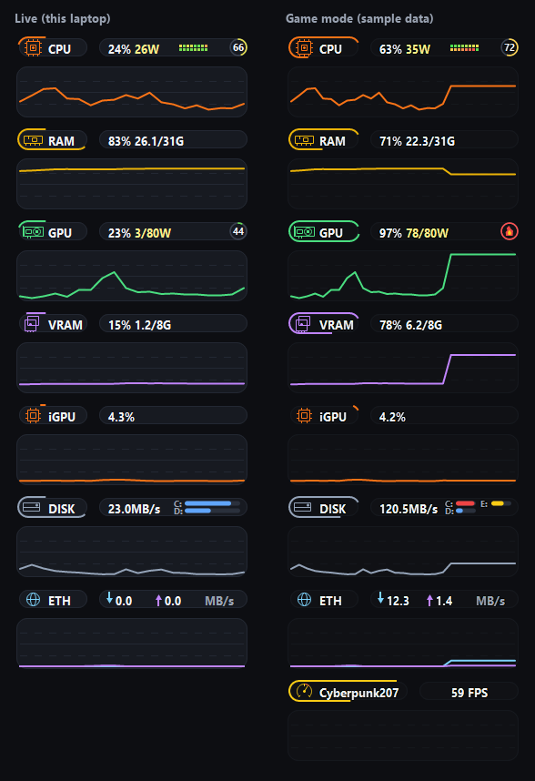

# Resource Monitor

Always-on-top, click-through, transparent pill monitor for Windows, docked in
the top-left corner of a display. Written in Rust (a rewrite of the earlier
Python/Tk version, with its bugs fixed and a fraction of its footprint).



## What it shows
One row per module: an **icon pill**, a **metrics pill**, and a 60 s **history
ribbon**. A "snake" runs around each icon pill; its length is the live value.

| Row | Metrics pill | Snake length |
|---|---|---|
| CPU | load %, package watts, per-core grid (green → red), temperature ring | CPU load |
| RAM | load %, used / total GB | RAM load |
| GPU | load %, watts / power limit, temperature ring | GPU load |
| VRAM | used %, used / total GB | VRAM used |
| iGPU | load % (row appears on activity, hides after 5 s at 0%) | iGPU load |
| DISK | transfer MB/s + a storage bar per drive (color = physical disk; red under 10% free, like Explorer) | storage used, all drives |
| ETH | download / upload MB/s | — |
| FPS | game name + FPS (row appears only while a game runs) | FPS / monitor refresh rate |

Temperature rings fill from 40 °C to 99 °C; above 99 °C they show a flame.
In **game mode** (a fullscreen game or a known game running) the pill
backgrounds fade to 25% and text gets a dark halo, so the overlay stays readable
without hiding the game.

## Controls
The window is click-through, so everything lives in the **tray icon**
(right-click; left-click does nothing):

- **Hide / Show**
- **Track** – history ribbons on/off
- **Size** – 1x / 1.5x / 2x
- **Display** – which monitor it docks on (only with 2+ displays)
- **Quit**

Choices persist in `settings.json` next to the app. The layout is DPI-aware.

## Build & run
Requires the Rust toolchain (MSVC). Windows 10/11 only.

```bat
cargo build --release
target\release\resource-monitor-rs.exe
```

Only one instance runs at a time. Optional elevated autostart (adds FPS and the
exact LibreHardwareMonitor CPU sensors), from an **elevated** PowerShell:

```powershell
.\setup_task.ps1
```

Off-screen self-test (no window; renders frames to `<dir>\*.rgba` and timings to
`selftest.txt`, including synthetic game-mode / scale / track-off frames):

```bat
target\release\resource-monitor-rs.exe --selftest <dir>
```

## Metric sources
Everything is read in-process with Windows APIs; no admin and no extra apps
are needed except where noted.

| Metric | Source | Admin |
|---|---|---|
| CPU % total + per core | `NtQuerySystemInformation` | no |
| CPU temperature | ACPI thermal zone (PDH `Thermal Zone Information`); the zone that actually moves is picked automatically | no |
| CPU package watts | RAPL (PDH `Energy Meter`, `RAPL_Package0_PKG`) | no |
| RAM | `GlobalMemoryStatusEx` | no |
| NVIDIA GPU load / VRAM / temp / watts / limit | NVML (`nvml.dll`, loaded at runtime) | no |
| iGPU %, non-NVIDIA dGPU % | PDH `GPU Engine`, per adapter LUID (adapters via D3DKMT) | no |
| Disk MB/s | PDH `PhysicalDisk(_Total)` | no |
| Drive usage + physical disk | `GetDiskFreeSpaceExW` (every 5 s) + `IOCTL_VOLUME_GET_VOLUME_DISK_EXTENTS` | no |
| Network MB/s | `GetIfEntry2` on physical NICs only | no |
| Game detection | fullscreen foreground window (per monitor) or a known game exe | no |
| FPS | PresentMon child process (`vendor/PresentMon`), game's main swap chain | **yes** |
| Exact CPU sensors (Tctl / package) | LibreHardwareMonitor via `vendor/lhm_bridge.ps1`; preferred when available | **yes** (or LHM app running) |

Helper processes run in a kill-on-close job object, so they never outlive the
monitor.

## Footprint
Measured on a Ryzen 7 7840HS + RTX 4060 Laptop (16 threads), 1x, all rows,
snakes at 60 fps, over 60 s:

| | Rust (this) | Python (previous) |
|---|---|---|
| CPU | **2.6% of one core** (0.16% of the whole CPU) | 5.7% of one core, snakes at 24 fps, plus 2 `nvidia-smi` launches per second |
| GPU | 0% | — |
| Memory | **36 MB** working set, 23 MB private (about 16 MB of it is NVIDIA's NVML) | 57 MB + a 56 MB helper process |
| Disk I/O | 0 KB | log line every second |
| Threads / GDI objects | 4 / 13 | — |
| Executable | 800 KB | Python + packages |

How it stays light:
- Metrics are sampled once per second on one background thread (~0.2 ms per tick).
- The static layer (pills, text, rings, ribbons) is redrawn once per second.
- The snakes live on a small separate overlay window over the icon column and
  are redrawn at the monitor refresh rate, paced by `DwmFlush`. Pacing stops
  when no snake moves or the monitor is hidden.
- Adapter discovery uses D3DKMT instead of DXGI, which would wake a sleeping
  NVIDIA GPU on hybrid laptops (2 W → 17 W).

## Fixed vs the Python version
- iGPU never showed: adapters were told apart by PDH `phys_N`, which is
  `phys_0` for both GPUs on hybrid laptops. Now per adapter LUID, using the
  busiest engine (no >100% overshoot).
- CPU temperature never read on AMD (the bridge only knew Intel's "Package"
  sensor) and never without admin. Now the ACPI thermal zone + RAPL, no admin.
- Dead controls: double-click / C / H / right-click bindings could never fire on
  a click-through window, and "hide to tray" had no way back.
- Rows reordered after toggling (the iGPU row came back under ETH; Track off/on
  moved every ribbon to the end).
- Game mode removed the pill backgrounds entirely instead of fading them.
- Fullscreen browsers / video players and maximized windows counted as games.
- FPS froze on its last value when a game stopped presenting frames, and mixed
  in launcher / overlay swap chains.
- Network double-counted WSL / Hyper-V virtual adapter traffic and spiked when
  an adapter reconnected.
- `app.log` grew by a line every second forever.
- The helper respawned every second when it could not run, and helpers were
  left running after the monitor was killed.
- Several instances could run at once; blurry on scaled displays; the autostart
  script had hardcoded user paths.
